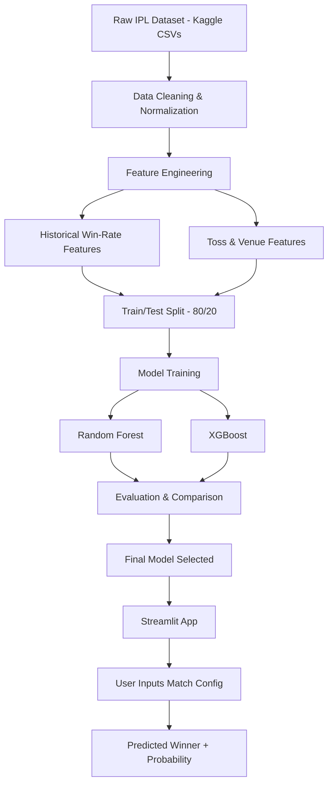

# 🏏 IPL Cricket Match Winner Prediction

Predicting IPL match winners using historical data, engineered cricket features, and machine learning — delivered as an interactive Streamlit app.

> **Status:** 🚧 In development — see [Project Status](#-project-status) below.

---

## 📋 Table of Contents

- [Overview](#-overview)
- [Problem Statement](#-problem-statement)
- [Features](#-features)
- [Tech Stack](#-tech-stack)
- [How It Works](#-how-it-works)
- [Repository Structure](#-repository-structure)
- [Dataset](#-dataset)
- [Methodology](#-methodology)
- [Getting Started](#-getting-started)
- [Usage](#-usage)
- [Model Performance](#-model-performance)
- [Project Status](#-project-status)
- [Limitations & Responsible Use](#-limitations--responsible-use)
- [Documentation](#-documentation)
- [Acknowledgments](#-acknowledgments)
- [License](#-license)

---

## 🎯 Overview

This project predicts the likely winner of an IPL (Indian Premier League) cricket match **before it starts**, using only information available pre-match: the two teams, the venue, the season, the toss winner, and the toss decision. It combines these with historical statistics — win rates, head-to-head records, venue trends — to produce a probability-based prediction.

Built as a complete, end-to-end data science project: data cleaning → feature engineering → model training & comparison → evaluation → an interactive Streamlit app.

## ❓ Problem Statement

Cricket analysts, fans, and students often rely on informal intuition to judge which team is likely to win a match — inconsistent, hard to justify, and impossible to compare across people. This project replaces that with a consistent, data-driven, explainable prediction, built on over a decade of historical IPL match data.

**This is an educational data science project — not a betting or gambling tool, and not a guarantee of real match outcomes.**

## ✨ Features

- ✅ Clean, leakage-safe historical win-rate features (overall, head-to-head, venue-specific, recent form)
- ✅ Team name normalization (handles renamed franchises, e.g. Delhi Daredevils → Delhi Capitals)
- ✅ Toss and venue advantage encoding
- ✅ Random Forest and XGBoost classifiers, compared against a simple baseline
- ✅ Model evaluation with Accuracy, F1-score, and ROC-AUC on an 80/20 split
- ✅ Interactive Streamlit app — pick two teams, a venue, and toss details, get a prediction with confidence
- ✅ Team performance analysis notebook (win rates, venue trends, toss trends)

## 🛠 Tech Stack

| Category | Tools |
|---|---|
| Language | Python 3.x |
| Data Processing | pandas, numpy |
| Machine Learning | scikit-learn, XGBoost |
| Visualization | matplotlib, seaborn |
| App / Deployment | Streamlit |
| Model Persistence | joblib |

## ⚙️ How It Works



**In short:** raw match data is cleaned, turned into meaningful features (computed only from *past* matches, to avoid data leakage), used to train and compare two classifiers, and the best one powers a simple web app.

## 📁 Repository Structure

```
ipl-match-winner-prediction/
├── data/
│   ├── raw/              # Raw IPL CSVs (not committed — see Dataset section)
│   └── processed/        # Cleaned dataset, generated by notebooks/scripts
├── notebooks/
│   ├── 01_data_cleaning_eda.ipynb
│   ├── 02_feature_engineering.ipynb
│   ├── 03_model_training_evaluation.ipynb
│   └── 04_team_performance_analysis.ipynb
├── src/
│   ├── data/              # Data loading & cleaning scripts
│   ├── features/          # Feature engineering module
│   └── models/            # Training & evaluation scripts
├── app/
│   └── streamlit_app.py   # Streamlit application
├── models/                 # Saved model artifacts (.pkl)
├── docs/                   # Full project documentation (blueprint, PRD)
├── reports/
│   └── figures/            # Exported charts for the final report
├── requirements.txt
├── .gitignore
└── README.md
```

## 📊 Dataset

**Source:** [IPL Complete Dataset 2008–2020 (Kaggle)](https://www.kaggle.com/datasets/patrickb1912/ipl-complete-dataset-20082020)

The core file used is the match-level dataset (`matches.csv`), where each row is one IPL match with season, teams, venue, toss details, and the winner. Raw CSV files are **not committed** to this repository — download them from Kaggle and place them in `data/raw/` before running the notebooks.

| File | Used for |
|---|---|
| `matches.csv` | Primary — match-level features and the training target |
| `deliveries.csv` (optional) | Ball-by-ball detail, used only for extended exploratory analysis, not the core model |

## 🔬 Methodology

1. **Data Cleaning** — handle missing values, remove duplicates and no-result matches, standardize team and venue names.
2. **Feature Engineering** — compute, for each match, only from *matches before it*:
   - Overall win rate per team
   - Head-to-head win rate between the two teams
   - Venue-specific win rate per team
   - Recent form (last 5 matches)
   - Toss winner / toss decision features
3. **Modeling** — train a simple baseline (e.g. "always predict the toss winner"), a `RandomForestClassifier`, and an `XGBClassifier`.
4. **Evaluation** — Accuracy, F1-score, ROC-AUC on an 80/20 train-test split, plus a chronological (train-on-older-seasons) sanity check against data leakage.
5. **Deployment** — the best model and its preprocessing pipeline are serialized together and loaded by the Streamlit app.

Full reasoning behind every design decision is in [`docs/`](./docs).

## 🚀 Getting Started

### Prerequisites
- Python 3.9+
- pip

### Installation
```bash
# clone the repository
git clone https://github.com/<your-username>/ipl-match-winner-prediction.git
cd ipl-match-winner-prediction

# install dependencies
pip install -r requirements.txt
```

### Dataset Setup
1. Download `matches.csv` (and optionally `deliveries.csv`) from [Kaggle](https://www.kaggle.com/datasets/patrickb1912/ipl-complete-dataset-20082020).
2. Place them in `data/raw/`.

## 🎮 Usage

### Run the notebooks (in order)
```bash
jupyter notebook notebooks/01_data_cleaning_eda.ipynb
```

### Train the model
```bash
python src/models/train_model.py
```

### Launch the Streamlit app
```bash
streamlit run app/streamlit_app.py
```
Then open the local URL Streamlit prints (usually `http://localhost:8501`), select two teams, a venue, and toss details, and click **Predict Winner**.

## 📈 Model Performance

*To be filled in once training is complete.*

| Model | Accuracy | F1-Score | ROC-AUC | Notes |
|---|---|---|---|---|
| Baseline (toss winner) | — | — | — | Reference point |
| Random Forest | — | — | — | |
| XGBoost | — | — | — | |

## 🗺 Project Status

- [x] Project planning & full documentation (BRD, PRD, HLD/LLD, model card, ADRs)
- [ ] **Month 1** — Data cleaning & exploratory data analysis
- [ ] **Month 2** — Feature engineering, model training & comparison
- [ ] **Month 3** — Streamlit app, final report & demo

## ⚠️ Limitations & Responsible Use

- Uses only pre-match, team/venue/toss-level data — no player-level stats or live ball-by-ball information.
- Cricket has real randomness (form on the day, injuries, weather, pressure) that this dataset cannot capture — predictions are probability estimates, not certainties.
- Performance for newer teams or rarely-used venues is naturally less reliable due to smaller historical sample sizes.
- **This tool is for educational and analytical purposes only — it is not intended for betting, gambling, or any financial decision-making.**

## 📚 Documentation

Full project documentation — including the Business Requirements Document, Product Requirements Document, UX design, technical architecture, testing strategy, model card, and Architecture Decision Records — is available in [`docs/`](./docs).

## 🙏 Acknowledgments

- Dataset: [IPL Complete Dataset 2008–2020](https://www.kaggle.com/datasets/patrickb1912/ipl-complete-dataset-20082020) by patrickb1912 on Kaggle.
- Built with [scikit-learn](https://scikit-learn.org/), [XGBoost](https://xgboost.readthedocs.io/), and [Streamlit](https://streamlit.io/).

## 📄 License

This project is for educational purposes as part of a Data Science coursework project.
