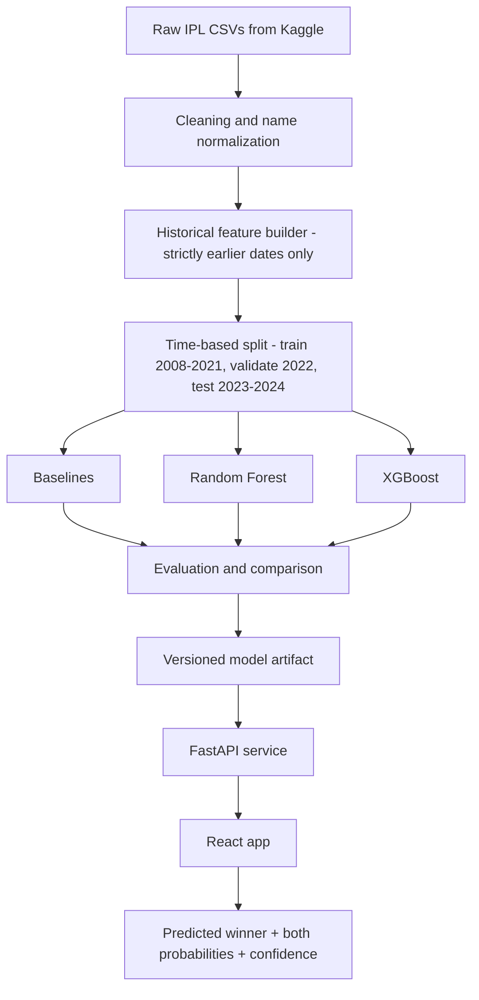

# 🏏 IPL Cricket Match Winner Prediction

Predicting IPL match winners from historical data, leakage-safe engineered features, and machine learning, delivered as a React web app backed by a FastAPI service.

> **Status:** 🚧 In development. Data pipeline and features are complete; model training is next. See [Project Status](#-project-status).
>
> Deliveries Dataset Notebook Link - https://colab.research.google.com/drive/1GWo_tiz41R_kuatZS6lSi3WlwsU1ElzV#scrollTo=c_cQvCh0SV1A
>
> Matches Dataset Notebook Link - https://colab.research.google.com/drive/19ptw6ECy6CwaFV5GSQMMdIiqzOUGLYXe#scrollTo=482dc108

Students: Hrituraj Roy (PST-25-0047) and Amul Rai (PST-25-0122). The detailed plan, decisions, and progress log are in [PROJECT.md](PROJECT.md).

---

## 📋 Table of Contents

- [Overview](#-overview)
- [Problem Statement](#-problem-statement)
- [Features](#-features)
- [Tech Stack](#-tech-stack)
- [How It Works](#-how-it-works)
- [Repository Structure](#-repository-structure)
- [Dataset](#-dataset)
- [Methodology](#-methodology)
- [Getting Started](#-getting-started)
- [Model Performance](#-model-performance)
- [Project Status](#-project-status)
- [Limitations & Responsible Use](#-limitations--responsible-use)
- [Documentation](#-documentation)
- [Acknowledgments](#-acknowledgments)
- [License](#-license)

---

## 🎯 Overview

This project estimates the probability that each of two IPL (Indian Premier League) teams wins a match. The prediction is made **after the toss and before the first ball**, using only what is known at that point: the two teams, the venue, the season, the toss winner, and the toss decision. These inputs are combined with historical statistics computed only from earlier matches, such as team ratings, recent form, head-to-head records, and venue trends.

It is an end-to-end data science project: data cleaning → feature engineering → model training and comparison → evaluation → a web app.

## ❓ Problem Statement

Cricket analysts, fans, and students often judge which team is likely to win by intuition, which is inconsistent, hard to justify, and impossible to compare across people. This project replaces that with a consistent, data-driven, explainable estimate built on 17 seasons of IPL match data.

**This is an educational data science project, not a betting or gambling tool, and not a guarantee of real match outcomes.**

## ✨ Features

✅ = done, 🔜 = planned

- ✅ Reproducible cleaning: renamed franchises merged (e.g. Delhi Daredevils → Delhi Capitals), 58 venue labels mapped to 36 grounds, no-result matches removed
- ✅ Exploratory analysis of seasons, teams, toss, venues, and class balance
- ✅ 38 leakage-safe historical features: Elo rating, overall and recent form, season record, head-to-head, venue record, home ground, toss and batting order
- ✅ Tests that fail if a future or same-day result leaks into a feature
- ✅ React frontend with a validated match form (not yet connected to a model)
- 🔜 Baselines, Random Forest, and XGBoost compared on a time-based split
- 🔜 Evaluation with accuracy, F1, ROC-AUC, confusion matrix, and calibration
- 🔜 FastAPI service returning both teams' probabilities, a confidence label, and the model version

## 🛠 Tech Stack

| Category | Tools |
|---|---|
| Language | Python 3.13 |
| Data processing | pandas, NumPy |
| Machine learning | scikit-learn, XGBoost |
| Visualization | matplotlib, seaborn |
| API | FastAPI (planned, Phase 6) |
| Frontend | React 19 + Vite |
| Testing | pytest |

## ⚙️ How It Works



Features for each match are computed only from matches on **earlier dates**, and the same code builds features for training and for live predictions.

## 📁 Repository Structure

```
├── data/
│   ├── raw/              # Kaggle CSVs (not committed, see Dataset)
│   └── processed/        # Rebuilt by the scripts; only the *manifest.json hash files are committed
├── notebooks/
│   └── 01_eda.ipynb      # Exploratory data analysis
├── src/
│   ├── data/             # inspect_raw.py, cleaning.py, mappings.py (team and venue names)
│   ├── features/         # builder.py (leakage-safe historical features)
│   └── models/           # Training and evaluation (Phase 4)
├── app/
│   ├── frontend/         # React + Vite web app
│   └── backend/          # FastAPI service (Phase 6)
├── models/               # Saved model artifacts (Phase 5)
├── reports/              # Data quality, cleaning, and EDA reports; figures/
├── docs/                 # Setup, data source, data dictionary, cleaning rules, feature spec
├── tests/                # pytest suite
├── PROJECT.md            # Plan, decisions, and progress log
└── requirements.txt
```

## 📊 Dataset

**Source:** [IPL Complete Dataset (2008–2024)](https://www.kaggle.com/datasets/patrickb1912/ipl-complete-dataset-20082020) by patrickb1912 on Kaggle, built from Cricsheet data. The URL still says 2008–2020, but the files run to the 2024 final.

| File | Used for |
|---|---|
| `matches.csv` | Primary: 1,095 matches (1,090 with a result), source of all features and the target |
| `deliveries.csv` (optional) | Ball-by-ball detail, exploration only |

Raw files are **not committed**. Download them from Kaggle into `data/raw/`; their SHA-256 hashes are checked so everyone uses the same version. See [docs/data_source.md](docs/data_source.md).

## 🔬 Methodology

1. **Cleaning:** merge renamed franchises and grounds, remove no-result matches, and use the match year as the season. Rules: [docs/cleaning_rules.md](docs/cleaning_rules.md).
2. **Features:** for each match, use only matches on strictly earlier dates. Small samples are smoothed toward 50%. Spec: [docs/features.md](docs/features.md).
3. **Modeling:** compare a coin-flip baseline, an Elo-only baseline, and logistic regression with Random Forest and XGBoost.
4. **Evaluation:** train on 2008–2021, tune on 2022, and test once on 2023–2024. A random split is not used, because it would let models learn from matches played after the ones they predict.
5. **Serving:** the chosen model and its feature specification are saved as one versioned artifact, loaded by the FastAPI service, and shown in the React app.

## 🚀 Getting Started

Full steps, including Windows notes, are in [docs/setup.md](docs/setup.md).

```powershell
git clone https://github.com/Roy-code5k/IPL_Match_Predictor-.git
cd IPL_Match_Predictor-

py -3.13 -m venv .venv
.venv\Scripts\Activate.ps1
pip install -r requirements.txt

# Put matches.csv and deliveries.csv from Kaggle in data/raw/, then:
python -m src.data.inspect_raw     # check file hashes and schema
python -m src.data.cleaning        # data/processed/matches_clean.csv
python -m src.features.builder     # data/processed/features.csv
python -m pytest                   # run the tests
```

Frontend (needs Node.js):

```powershell
cd app\frontend
npm.cmd install
npm.cmd run dev                    # open http://localhost:5173/
```

## 📈 Model Performance

*To be filled in after Phase 5 evaluation on the 2023–2024 test seasons.*

| Model | Accuracy | F1-score | ROC-AUC | Notes |
|---|---|---|---|---|
| Coin flip / Elo baseline | — | — | — | Reference points |
| Logistic regression | — | — | — | |
| Random Forest | — | — | — | |
| XGBoost | — | — | — | |

Pre-match signal in the IPL is weak (single-feature ROC-AUC is about 0.52–0.55), so accuracy is expected to be only a few points above 50%.

## 🗺 Project Status

- [x] Phase 1: setup, data source, data dictionary, quality report
- [x] Phase 2: cleaning pipeline and EDA ([reports/eda_findings.md](reports/eda_findings.md))
- [x] Phase 3: leakage-safe historical features ([docs/features.md](docs/features.md))
- [ ] Phase 4: baselines, Random Forest, XGBoost
- [ ] Phase 5: evaluation and versioned model artifact
- [ ] Phase 6: FastAPI service and connected React UI (frontend shell already built)
- [ ] Phases 7–8: polish, final report, and demo

## ⚠️ Limitations & Responsible Use

- Uses only pre-match team, venue, and toss information: no player-level stats or live ball-by-ball data.
- Cricket has real randomness (form on the day, injuries, weather, pressure) that this dataset cannot capture. Predictions are probability estimates, not certainties.
- Predictions for new teams or rarely used venues are less reliable because they have little history.
- **This tool is for educational and analytical purposes only. It is not intended for betting, gambling, or any financial decision.**

## 📚 Documentation

| Document | Contents |
|---|---|
| [PROJECT.md](PROJECT.md) | Scope, decisions, plan, and progress log |
| [docs/setup.md](docs/setup.md) | Local setup and rebuilding the data |
| [docs/data_source.md](docs/data_source.md) | Dataset source and pinned version |
| [docs/data_dictionary.md](docs/data_dictionary.md) | Every raw column |
| [docs/cleaning_rules.md](docs/cleaning_rules.md) | Cleaning and name-mapping rules |
| [docs/features.md](docs/features.md) | Feature definitions and leakage rules |
| [reports/](reports/) | Data quality, cleaning, and EDA reports |

## 🙏 Acknowledgments

- Dataset: [IPL Complete Dataset](https://www.kaggle.com/datasets/patrickb1912/ipl-complete-dataset-20082020) by patrickb1912 on Kaggle, built from [Cricsheet](https://cricsheet.org/) data.
- Built with [pandas](https://pandas.pydata.org/), [scikit-learn](https://scikit-learn.org/), [XGBoost](https://xgboost.readthedocs.io/), [React](https://react.dev/), and [Vite](https://vite.dev/).

## 📄 License

This project is for educational purposes as part of a data science coursework project.
