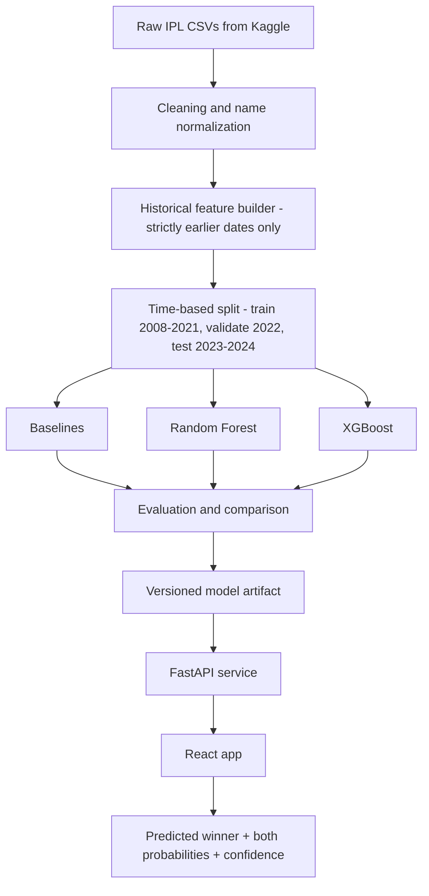
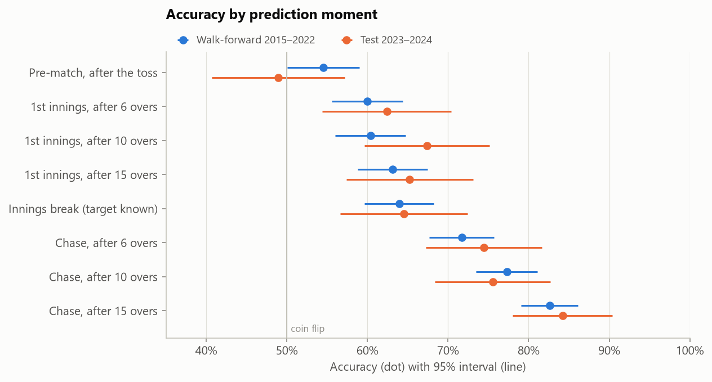

# 🏏 IPL Cricket Match Winner Prediction

Predicting IPL match winners from historical data, leakage-safe engineered features, and machine learning, delivered as a React web app backed by a FastAPI service.

> **Status:** ✅ Feature-complete and verified (November 2026). The models are tested and served by a FastAPI service, and the React app makes pre-match, live and batch predictions. The final report is in [reports/final_report.md](reports/final_report.md). See [Project Status](#-project-status).
>
> Deliveries Dataset Notebook Link - https://colab.research.google.com/drive/1GWo_tiz41R_kuatZS6lSi3WlwsU1ElzV#scrollTo=c_cQvCh0SV1A
>
> Matches Dataset Notebook Link - https://colab.research.google.com/drive/19ptw6ECy6CwaFV5GSQMMdIiqzOUGLYXe#scrollTo=482dc108

Students: Hrituraj Roy (PST-25-0047) and Amul Rai (PST-25-0122). The detailed plan, decisions, and progress log are in [PROJECT.md](PROJECT.md).

---

## 📋 Table of Contents

- [Overview](#-overview)
- [Problem Statement](#-problem-statement)
- [Features](#-features)
- [Tech Stack](#-tech-stack)
- [How It Works](#-how-it-works)
- [Repository Structure](#-repository-structure)
- [Dataset](#-dataset)
- [Methodology](#-methodology)
- [Getting Started](#-getting-started)
- [Model Performance](#-model-performance)
- [Project Status](#-project-status)
- [Limitations & Responsible Use](#-limitations--responsible-use)
- [Documentation](#-documentation)
- [Acknowledgments](#-acknowledgments)
- [License](#-license)

---

## 🎯 Overview

This project estimates the probability that each of two IPL (Indian Premier League) teams wins a match. The prediction is made **after the toss and before the first ball**, using only what is known at that point: the two teams, the venue, the season, the toss winner, and the toss decision. These inputs are combined with historical statistics computed only from earlier matches, such as team ratings, recent form, head-to-head records, and venue trends.

A second **live mode** updates the probability during the match from the current score: runs, wickets, completed overs and, in the chase, the target. Before the first ball the outcome is close to a coin flip (49–54% accuracy); once the match is under way the score carries much more signal (about 75–77% after 10 overs of the chase, 82–84% after 15). Accuracy is always reported per prediction moment.

It is an end-to-end data science project: data cleaning → feature engineering → model training and comparison → evaluation → a web app.

## ❓ Problem Statement

Cricket analysts, fans, and students often judge which team is likely to win by intuition, which is inconsistent, hard to justify, and impossible to compare across people. This project replaces that with a consistent, data-driven, explainable estimate built on 17 seasons of IPL match data.

**This is an educational data science project, not a betting or gambling tool, and not a guarantee of real match outcomes.**

## ✨ Features

✅ = done, 🔜 = planned

- ✅ Reproducible cleaning: renamed franchises merged (e.g. Delhi Daredevils → Delhi Capitals), 58 venue labels mapped to 36 grounds, no-result matches removed
- ✅ Exploratory analysis of seasons, teams, toss, venues, and class balance
- ✅ 38 leakage-safe historical features: Elo rating, overall and recent form, season record, head-to-head, venue record, home ground, toss and batting order
- ✅ Tests that fail if a future or same-day result leaks into a feature
- ✅ React frontend: pre-match and live prediction forms, results with both probabilities and a confidence label, and test metrics loaded from the model release
- ✅ Coin-flip and Elo baselines, logistic regression, Random Forest, and XGBoost compared on a time-based split (walk-forward 2015–2022 and 2022 validation)
- ✅ Live win-probability models for every over of both innings, built from `deliveries.csv` with a leakage-safe par score
- ✅ Metrics: accuracy with 95% intervals, F1, ROC-AUC, log loss, Brier score, confusion matrix, and calibration tables
- ✅ Confidence labels fixed before testing, one evaluation on the 2023–2024 test seasons, and a versioned, hash-checked model release with a `Predictor` loader
- ✅ FastAPI service returning both teams' probabilities, a confidence label, and the model version (pre-match and live), with stable error codes and request ids
- ✅ Prediction log (inputs, outputs, model version, request id, response time) with CSV export
- ✅ Batch predictions from a CSV of up to 200 matches, with CSV download of the results
- ✅ Each result lists the key inputs the model used; the dashboard compares every model against the baselines
- ✅ Final verification (174 Python and 7 frontend tests, byte-identical rebuild, predictions well under a second), final report, and demo script
- ✅ Past-dated scenarios are labelled as retrospective simulations, because the released model was trained through 2024-05-26

## 🛠 Tech Stack

| Category | Tools |
|---|---|
| Language | Python 3.13 |
| Data processing | pandas, NumPy |
| Machine learning | scikit-learn, XGBoost |
| Visualization | matplotlib, seaborn |
| API | FastAPI + uvicorn |
| Frontend | React 19 + Vite |
| Testing | pytest |

## ⚙️ How It Works



Features for each match are computed only from matches on **earlier dates**, and the same code builds features for training and for live predictions.

## 📁 Repository Structure

```
├── data/
│   ├── raw/              # Kaggle CSVs (not committed, see Dataset)
│   └── processed/        # Rebuilt by the scripts; only the *manifest.json hash files are committed
├── notebooks/
│   └── 01_eda.ipynb      # Exploratory data analysis
├── src/
│   ├── data/             # inspect_raw.py, cleaning.py, mappings.py (team and venue names)
│   ├── features/         # builder.py (pre-match features), live.py (in-match states)
│   └── models/           # evaluation, prematch, live, calibration, release, predictor
├── app/
│   ├── frontend/         # React + Vite web app
│   └── backend/          # FastAPI service (main.py routes, schemas.py request/response models)
├── models/               # release-1.0.0/ (rebuilt by src.models.release; only metadata.json is committed)
├── reports/              # Data quality, cleaning, EDA, model and verification reports, final report; figures/
├── docs/                 # Setup, architecture, data, features, models, limitations, demo script
├── tests/                # pytest suite
├── PROJECT.md            # Plan, decisions, and progress log
└── requirements.txt
```

## 📊 Dataset

**Source:** [IPL Complete Dataset (2008–2024)](https://www.kaggle.com/datasets/patrickb1912/ipl-complete-dataset-20082020) by patrickb1912 on Kaggle, built from Cricsheet data. The URL still says 2008–2020, but the files run to the 2024 final.

| File | Used for |
|---|---|
| `matches.csv` | Primary: 1,095 matches (1,090 with a result), source of all features and the target |
| `deliveries.csv` | Ball-by-ball detail for the live mode: the score at each over and the par score |

Raw files are **not committed**. Download them from Kaggle into `data/raw/`; their SHA-256 hashes are checked so everyone uses the same version. See [docs/data_source.md](docs/data_source.md).

## 🔬 Methodology

1. **Cleaning:** merge renamed franchises and grounds, remove no-result matches, and use the match year as the season. Rules: [docs/cleaning_rules.md](docs/cleaning_rules.md).
2. **Features:** for each match, use only matches on strictly earlier dates. Small samples are smoothed toward 50%. Spec: [docs/features.md](docs/features.md).
3. **Modeling:** compare a coin-flip baseline, an Elo-only baseline, and logistic regression with Random Forest and XGBoost. Pre-match models train on both team orders so the listing order cannot change a prediction. Live models (one per innings) use the score at the end of each over. Spec: [docs/live_model.md](docs/live_model.md).
4. **Evaluation:** train on 2008–2021, tune on 2022, and test once on 2023–2024. Because 2022 has only 74 matches, candidates are also compared walk-forward over 2015–2022, and the lowest walk-forward log loss is selected. A random split is not used, because it would let models learn from matches played after the ones they predict.
5. **Serving:** the chosen model and its feature specification are saved as one versioned artifact, loaded by the FastAPI service, and shown in the React app.

## 🚀 Getting Started

Full steps, including Windows notes, are in [docs/setup.md](docs/setup.md).

```powershell
git clone https://github.com/Roy-code5k/IPL_Match_Predictor-.git
cd IPL_Match_Predictor-

py -3.13 -m venv .venv
.venv\Scripts\Activate.ps1
pip install -r requirements.txt

# Put matches.csv and deliveries.csv from Kaggle in data/raw/, then:
python -m src.data.inspect_raw     # check file hashes and schema
python -m src.data.cleaning        # data/processed/matches_clean.csv
python -m src.features.builder     # data/processed/features.csv
python -m src.models.prematch      # reports/prematch_models.md
python -m src.models.live          # reports/live_models.md
python -m src.models.release       # test evaluation + models/release-1.0.0/
python -m pytest                   # run the tests
```

Run the app (needs Node.js), in two terminals:

```powershell
python -m uvicorn app.backend.main:app --port 8000   # API; docs at http://127.0.0.1:8000/api/docs

cd app\frontend
npm.cmd install
npm.cmd run dev                    # open http://localhost:5173/ (forwards /api to port 8000)
```

## 📈 Model Performance

Selection and confidence labels were fixed on 2015–2022 data before the 2023–2024 test seasons were evaluated, once. Full tables: [reports/model_evaluation.md](reports/model_evaluation.md) (test), [reports/prematch_models.md](reports/prematch_models.md) and [reports/live_models.md](reports/live_models.md) (model comparison), [docs/model_release.md](docs/model_release.md) (findings).

| Prediction moment | Selected model | Walk-forward 2015–2022 | Test 2023–2024 | Test ROC-AUC |
|---|---|---|---|---|
| Pre-match, after the toss | Random Forest | 54.2% | 48.6% | 0.525 |
| 1st innings, after 10 overs | Logistic regression | 60.4% | 67.4% | 0.707 |
| Innings break (target known) | Logistic regression | 63.9% | 64.5% | 0.746 |
| Chase, after 6 overs | Logistic regression | 71.7% | 74.5% | 0.825 |
| Chase, after 10 overs | Logistic regression | 77.3% | 75.5% | 0.857 |
| Chase, after 15 overs | Logistic regression | 82.6% | 84.2% | 0.933 |



- **Walk-forward:** each season from 2015 to 2022 predicted by a model trained only on earlier seasons (about 480 matches). **Test:** trained on 2008–2022, scored on 2023–2024 (144 matches; ±8 points at 95%).
- Live rows count only matches still in progress at that point.
- **Pre-match prediction did not beat a coin flip on the test seasons.** The chasing side won 55% of matches in 2008–2022, but the side batting first won 52% in 2023–2024, when scores rose sharply, so models that learned the chase advantage misjudged the new seasons. Pre-match probabilities are best read as close to 50/50.
- The released models are refitted on 2008–2024 with the same settings.

## 🗺 Project Status

- [x] Phase 1: setup, data source, data dictionary, quality report
- [x] Phase 2: cleaning pipeline and EDA ([reports/eda_findings.md](reports/eda_findings.md))
- [x] Phase 3: leakage-safe historical features ([docs/features.md](docs/features.md))
- [x] Phase 4: baselines, Random Forest, XGBoost, and live win-probability models
- [x] Phase 5: confidence labels, one test evaluation, and versioned model release
- [x] Phase 6: FastAPI service and connected React UI (pre-match and live)
- [x] Phase 7: prediction log, CSV export, batch predictions, model inputs, model comparison (prediction log kept as a file; MongoDB not needed for now)
- [x] Phase 8: final verification, final report, and demo script (rehearsal by the team pending)

## ⚠️ Limitations & Responsible Use

- The pre-match model uses only team, venue, and toss information, with no player-level stats. It is close to a coin flip: 54% on 2015–2022 and 49% on the 2023–2024 test seasons.
- The live mode needs the score entered by the user (no live feed) and leaves out rain-affected (D/L) matches.
- Cricket has real randomness (form on the day, injuries, weather, pressure) that this dataset cannot capture. Predictions are probability estimates, not certainties.
- Predictions for new teams or rarely used venues are less reliable because they have little history.
- A scenario dated on or before 2024-05-26 is a retrospective simulation, not a forecast: the released model has already been trained on those matches. The app labels these results.
- The full list, with evidence, is in [docs/model_limitations.md](docs/model_limitations.md).
- **This tool is for educational and analytical purposes only. It is not intended for betting, gambling, or any financial decision.**

## 📚 Documentation

| Document | Contents |
|---|---|
| [reports/final_report.md](reports/final_report.md) | **Final report:** method, results, the application, limitations |
| [PROJECT.md](PROJECT.md) | Scope, decisions, plan, and progress log |
| [docs/setup.md](docs/setup.md) | Local setup, rebuilding everything, and verification |
| [docs/architecture.md](docs/architecture.md) | How the pipeline, model release, API and web app fit together |
| [docs/data_source.md](docs/data_source.md) | Dataset source and pinned version |
| [docs/data_dictionary.md](docs/data_dictionary.md) | Every raw column |
| [docs/cleaning_rules.md](docs/cleaning_rules.md) | Cleaning and name-mapping rules |
| [docs/features.md](docs/features.md) | Feature definitions and leakage rules |
| [docs/live_model.md](docs/live_model.md) | Live mode: states, features, and evaluation |
| [docs/model_release.md](docs/model_release.md) | Test protocol, results, confidence labels, and loading a release |
| [docs/model_limitations.md](docs/model_limitations.md) | What the models can and cannot tell you |
| [docs/demo_script.md](docs/demo_script.md) | Step-by-step demo with expected results and likely questions |
| [reports/verification.md](reports/verification.md) | Final checks: tests, reproducibility, speed, browser checks |
| [reports/](reports/) | Data quality, cleaning, EDA, and model comparison reports |

## 🙏 Acknowledgments

- Dataset: [IPL Complete Dataset](https://www.kaggle.com/datasets/patrickb1912/ipl-complete-dataset-20082020) by patrickb1912 on Kaggle, built from [Cricsheet](https://cricsheet.org/) data.
- Built with [pandas](https://pandas.pydata.org/), [scikit-learn](https://scikit-learn.org/), [XGBoost](https://xgboost.readthedocs.io/), [React](https://react.dev/), and [Vite](https://vite.dev/).

## 📄 License

This project is for educational purposes as part of a data science coursework project.
