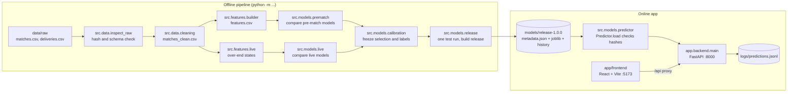

# Architecture

The project has two halves:

- An **offline pipeline** turns the raw CSVs into a tested, versioned model release.
- An **online app** loads that release and answers prediction requests.

Nothing is trained while the app is running.

## Offline pipeline

Each step is a module run with `python -m`. It reads the previous step's files and writes its own, and it is deterministic, so running the steps again gives byte-identical output. Commands and timings are in [setup.md](setup.md).

| Step | Module | Reads | Writes |
|---|---|---|---|
| Check raw data | `src.data.inspect_raw` | `data/raw/*.csv` | `reports/data_quality_report.md` (fails on a hash mismatch) |
| Clean | `src.data.cleaning` (rules in `src/data/mappings.py`) | `matches.csv` | `data/processed/matches_clean.csv`, `manifest.json`, `reports/cleaning_report.md` |
| Pre-match features | `src.features.builder` | `matches_clean.csv` | `data/processed/features.csv`, `features_manifest.json` |
| Live states | `src.features.live` (called by the model scripts) | `deliveries.csv`, `matches_clean.csv` | in memory |
| Compare pre-match models | `src.models.prematch` | features | `reports/prematch_models.md` |
| Compare live models | `src.models.live` | live states | `reports/live_models.md`, figure 08 |
| Freeze selection and labels | `src.models.calibration`, `src.models.confidence` | pre-test data only | `reports/calibration_review.md` |
| Test once, build release | `src.models.release` | everything above, plus the 2023–2024 test seasons | `reports/model_evaluation.md`, figure 09, `models/release-1.0.0/` |

Shared building blocks:

- `src/data/mappings.py`: the team and venue name mappings and home cities. Both cleaning and serving use them, so a name means the same thing everywhere.
- `src/models/evaluation.py`: the season split (train 2008–2021, validate 2022, test 2023–2024), walk-forward evaluation and all metrics. Only `final_test` reads the test seasons.
- `match_features` (pre-match) and `state_features` (live) are each a single function used both to build training rows and to answer requests. Tests check that the two paths give identical rows.

## The model release

`models/release-1.0.0/` is one self-contained, versioned set:

| File | Contents | In git |
|---|---|---|
| `metadata.json` | Version, training seasons, history cutoff, feature lists, estimator settings, confidence bands, test metrics for every candidate, input data hashes, package versions, SHA-256 of every other file | Yes |
| `prematch.joblib` | Random Forest, trained on both team orders | No (rebuilt) |
| `live_innings1.joblib`, `live_innings2.joblib` | Logistic regression per innings | No (rebuilt) |
| `history.csv` | The 1,090 matches the pre-match features are computed from | No (rebuilt) |
| `first_innings_totals.csv` | Earlier first-innings totals, for the live par score | No (rebuilt) |

`Predictor.load()` (`src/models/predictor.py`):

- refuses to start if any file's hash differs from `metadata.json`;
- warns if the installed package versions differ from those recorded.

A future release would go in its own folder (for example `release-1.1.0/`). Point the API at it with the `IPL_RELEASE_DIR` environment variable. Rolling back means pointing it at the old folder again.

## API (`app/backend/`)

| File | Role |
|---|---|
| `main.py` | `create_app()`: loads the release once at startup, defines the routes, request-id middleware and error handlers |
| `schemas.py` | Pydantic request and response models and the input rules (teams differ, toss winner is playing, date inside the season, valid live score) |
| `store.py` | Prediction log behind a small interface (`write`, `read_all`); the current backend writes JSON lines |

| Route | Purpose |
|---|---|
| `GET /api/v1/health` | Whether the model is loaded, its release and its history cutoff |
| `GET /api/v1/options` | Teams per season, grounds, supported seasons, batch limits (drives the form) |
| `GET /api/v1/model-metrics` | Test metrics and the model comparison from `metadata.json` |
| `POST /api/v1/predict` | Pre-match prediction |
| `POST /api/v1/predict-live` | Prediction from the score at the end of an over |
| `POST /api/v1/predict-batch` | Up to 200 rows of CSV text; each row is pre-match or live; bad rows get an error message |
| `GET /api/v1/predictions/log.csv` | The prediction log as CSV |
| `GET /api/docs` | Interactive API documentation |

Every response carries an `X-Request-ID` header. An error returns `{"error": {"code", "message", "request_id"}}` with a stable code:

| Code | HTTP status | Meaning |
|---|---|---|
| `INVALID_REQUEST` | 422 | The request fails the input rules |
| `UNKNOWN_NAME`, `TEAM_NOT_IN_SEASON` | 400 | A team or ground the model can't use |
| `INVALID_INPUT`, `INVALID_MATCH_STATE` | 400 | The inputs or live score are impossible |
| `INVALID_CSV`, `TOO_MANY_ROWS` | 400 | Batch problems |
| `MODEL_UNAVAILABLE` | 503 | The release is missing or fails its hash check (`/health` still answers) |
| `INTERNAL_ERROR` | 500 | Anything else |

Every prediction is appended to `logs/predictions.jsonl`. So are each batch row and each request the model rejects, such as a team not in the season or an impossible score. A request that fails the basic schema check (422) is not logged. Each line holds:

- the inputs and outputs;
- the model release and name;
- the request id;
- the response time.

Settings:

| Variable | Default | Effect |
|---|---|---|
| `IPL_RELEASE_DIR` | `models/release-1.0.0` | Which release to load |
| `IPL_LOG_DIR` | `logs/` | Where the prediction log is written |
| `IPL_LOG` | on | `off` turns logging off |

## Web app (`app/frontend/`)

React 19 with Vite. In development, Vite serves the app on port 5173 and forwards `/api` to port 8000, so the browser only ever talks to one address.

| File | Role |
|---|---|
| `src/App.jsx` | All sections: overview, how it works, match predictor (pre-match and live), batch, findings (team analysis), model performance, about |
| `src/api.js` | Fetch client, the `ApiError` type, and CSV download helpers |
| `src/data.js` | Historical summaries for the findings section. `tests/test_frontend_data.py` keeps them in line with the Python mappings. |
| `src/styles.css` | The visual theme; layouts that work at phone width |

The form checks inputs as the user types, using the same rules as the API, and marks each invalid field with its message. The API checks everything again. If the API is unreachable, the app says so and shows the command to start it.

## Design decisions

- **Train offline, serve a saved release.** Predictions are fast (about 33 ms) and repeatable, and every displayed metric belongs to the model that is actually loaded.
- **One feature function for training and serving.** This removes the most common source of training/serving mismatch.
- **Strictly earlier dates only.** Same-day matches never see each other, because the data has no start times.
- **Symmetric pre-match model.** It is trained on both team orders and averages both at prediction time. Swapping Team A and Team B swaps the probabilities exactly.
- **The log behind an interface.** A database backend (for example MongoDB) can replace the JSON-lines file without touching the routes.
