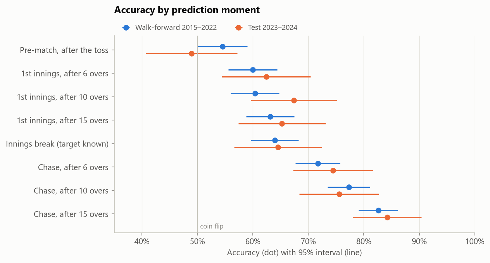
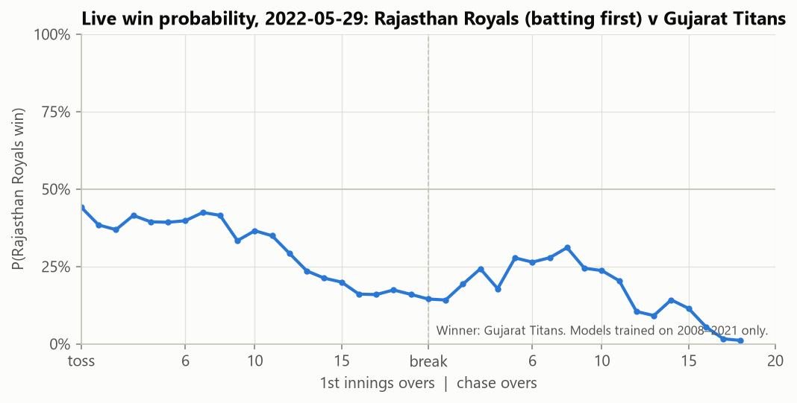
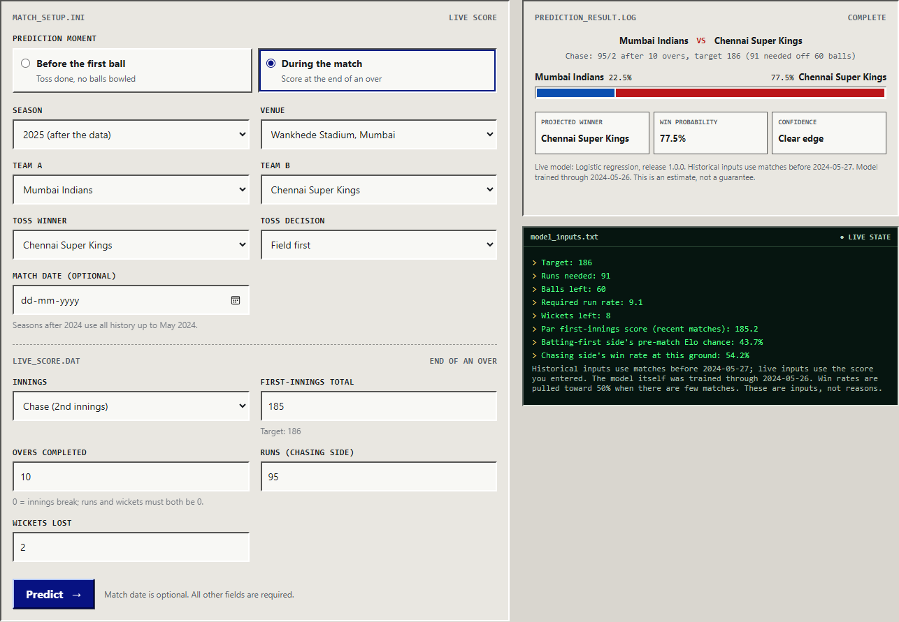
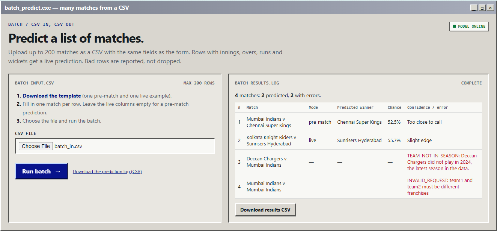
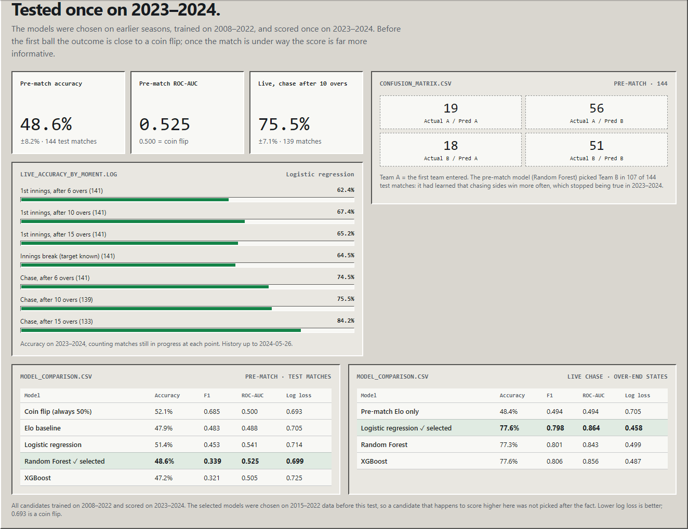

# IPL Cricket Match Winner Prediction: final report

**Students:** Hrituraj Roy (PST-25-0047) and Amul Rai (PST-25-0122)
**Course stage:** Semester 3, data science and machine learning project
**Date:** November 2026
**Repository:** https://github.com/Roy-code5k/IPL_Match_Predictor-

## Summary

We built a web application that estimates each team's chance of winning an Indian Premier League (IPL) match. It has two modes:

- **Pre-match:** a prediction after the toss, before the first ball.
- **Live:** an updated prediction from the score at the end of any over.

We used 1,090 decided IPL matches (2008–2024) and 260,920 ball-by-ball records. We built 38 historical features that use only matches played on earlier dates. Five pre-match models and four live models per innings were compared on a time-based split, with the models chosen on 2015–2022 data before the 2023–2024 test seasons were evaluated, once.

**The main finding is that pre-match prediction is close to a coin flip, while live prediction is useful.**

- **Pre-match:** the best model was right 54.2% of the time on 2015–2022, and 48.6% on the 2023–2024 test seasons, which is no better than chance. We trace the test failure to a change in the game: the chasing side used to win 55% of matches, but in 2023–2024 the side batting first won 52%.
- **Live:** accuracy rises as the match goes on: 64.5% at the innings break, 75.5% after 10 overs of the chase and 84.2% after 15 (test seasons).

The selected models are served by a FastAPI service and a React app. The app shows:

- both probabilities, a confidence label in words and the inputs the model used;
- the test metrics of the model that is actually loaded;
- batch predictions from CSV, and CSV downloads.

There are 174 automated Python tests and 7 frontend tests. The whole pipeline rebuilds byte for byte from the raw data in under two minutes.

## 1. Problem and objectives

Fans, analysts and students often judge who will win a match by intuition. That is hard to justify and hard to compare. Our goal was a consistent, data-driven estimate with honest uncertainty. The objectives were to:

1. Clean and document a public IPL dataset reproducibly.
2. Build historical features that never use information from the future.
3. Compare baselines with Random Forest and XGBoost on seasons the models have not seen.
4. Serve the chosen model in a web app that shows probabilities, uncertainty and model performance.

This is an educational tool, not a betting product, and its estimates are not guarantees.

## 2. Data

**Source.** The [IPL Complete Dataset (2008–2024)](https://www.kaggle.com/datasets/patrickb1912/ipl-complete-dataset-20082020) by patrickb1912 on Kaggle, built from [Cricsheet](https://cricsheet.org/) data. The raw files are pinned by SHA-256 hash, so everyone uses the same version (`docs/data_source.md`).

| File | Contents |
|---|---|
| `matches.csv` | 1,095 matches from 2008-04-18 to the 2024 final (2024-05-26), 20 columns |
| `deliveries.csv` | 260,920 deliveries covering every match |

**Cleaning** (`src/data/cleaning.py`, rules in `docs/cleaning_rules.md`):

- Removed the 5 no-result matches, leaving 1,090 decided matches.
- Merged renamed franchises, so 19 raw team names became 15 franchises (for example Delhi Daredevils → Delhi Capitals). Different franchises, such as Deccan Chargers and Sunrisers Hyderabad, stay separate.
- Mapped 58 raw venue labels to 36 grounds.
- Took the season as the year of the match date. The raw labels mixed "2009/10" with "2010".
- Excluded every field set during or after a match (result, margin, player of the match, target) from the model inputs.

## 3. Exploratory analysis

The EDA notebook (`notebooks/01_eda.ipynb`, summary in `reports/eda_findings.md`) shaped the modelling decisions:

| Finding | Consequence |
|---|---|
| The listed Team A wins 50.9% of matches, so the classes are balanced, but the listing order is arbitrary | Accuracy is a fair headline metric. Models are trained on both team orders, so the order cannot change a prediction. |
| The toss winner wins 50.8% | The toss alone is a coin flip, the floor every model must beat |
| Fielding first rose from under half of tosses (2009–2013) to about three quarters (2016 on); chasing sides won 54.1% overall | Patterns drift over time, so evaluation must use a time-based split |
| Team win rates swing widely from season to season | Recent form and season-to-date record should matter more than all-time record |
| Chasing win rates by ground range from 42% to 65% | A smoothed venue chase rate is a candidate feature |
| New franchises (Gujarat Titans, Lucknow Super Giants) have little history | Rates are smoothed toward 50%, so new teams need no special case |

Charts: `reports/figures/01`–`07`.

## 4. Method

### 4.1 Prediction moment and leakage rules

A pre-match prediction is made after the toss and before the first ball. Features for a match use only matches on **strictly earlier dates**. Two matches were played on 272 dates and the data has no start times, so same-day matches never see each other. Training rows and served predictions are built by the same function. Tests check this, along with leakage: changing any result changes nothing on or before its date.

### 4.2 Pre-match features (38, `docs/features.md`)

- Elo ratings (start 1500, K = 20, partly reset each season).
- Overall, last-5 and last-10 form.
- Season-to-date and previous-season record.
- Head-to-head record and each team's record at the ground.
- Home ground (turned off for 2020–2022, when no team played at home).
- Toss winner, toss decision and the batting order they imply.
- Ground and league chasing rates.

Small samples are smoothed toward 50%.

No single feature is strong: the best single-feature ROC-AUC on training data is about 0.55. That was the first sign that pre-match signal is weak.

### 4.3 Live states and features (`docs/live_model.md`)

From `deliveries.csv` we took the score at the end of every over of both innings. Only states where the match was still undecided were kept.

- **Excluded:** the 29 rain-affected (D/L or shortened) matches, because their target is not "first-innings total + 1 in 20 overs".
- **Features:**
  - **Both innings:** balls left, runs and wickets.
  - **First innings:** the projected score against a **par score**, the smoothed average of the previous 60 first-innings totals, which moves as league scoring changes.
  - **Chase:** runs needed and the required rate.
  - **Context:** a pre-match Elo probability and the ground's chasing rate.
- **One model per innings.**

### 4.4 Models

- **Baselines:** a coin flip (always 50%) and an Elo-only model.
- **Pre-match candidates:** logistic regression, Random Forest (500 trees, depth 5) and XGBoost (300 trees, depth 3). All settings and seeds were fixed before results were seen.
- **Live candidates:** Elo only, logistic regression, Random Forest and XGBoost.

### 4.5 Evaluation design

- **Time-based split, never random:** train 2008–2021 (872 matches), validate 2022 (74), test 2023–2024 (144). A random split would let a model learn from matches played after the ones it predicts.
- **Walk-forward comparison:** 2022 alone is small, so each season from 2015 to 2022 was predicted by a model trained only on earlier seasons (489 matches in all).
- **Selection rule, fixed in advance:** the lowest walk-forward log loss. Log loss rewards honest probabilities, not just correct picks.
- **Test once:** the model choice and the confidence labels were committed to git (`4c34e4b`) before the test seasons were read. Nothing was tuned afterwards.
- **Metrics:**
  - accuracy with a 95% interval;
  - F1, ROC-AUC, log loss and Brier score;
  - confusion matrix;
  - calibration tables;
  - results by team and by season.

### 4.6 Confidence labels

The label depends on the favourite's probability:

| Favourite's probability | Label |
|---|---|
| Below 55% | Too close to call, flagged in text as well as visually |
| 55–65% | Slight edge |
| 65–80% | Clear edge |
| 80% and above | Strong edge |

The thresholds were set on 2015–2022 predictions. The calibration review found no need to recalibrate (`reports/calibration_review.md`).

## 5. Results

### 5.1 Pre-match

| Model | Walk-forward 2015–2022 accuracy | ROC-AUC | Log loss | Test 2023–2024 accuracy | Test ROC-AUC | Test log loss |
|---|---|---|---|---|---|---|
| Coin flip (always 50%) | 47.4% | 0.500 | 0.693 | 52.1% | 0.500 | 0.693 |
| Elo baseline | 51.1% | 0.515 | 0.702 | 47.9% | 0.488 | 0.705 |
| Logistic regression | 52.6% | 0.551 | 0.698 | 51.4% | 0.541 | 0.714 |
| **Random Forest (selected)** | **54.2%** | 0.546 | **0.690** | **48.6%** | 0.525 | 0.699 |
| XGBoost | 53.2% | 0.540 | 0.710 | 47.2% | 0.505 | 0.726 |

Walk-forward intervals are about ±4.4 points; test intervals are about ±8.2 points.

The Random Forest was the only model to beat the coin flip's log loss on 2015–2022, so the rule selected it. On the test seasons it did not beat chance, and neither did any other candidate. The coin flip's accuracy is simply the share of matches Team A won, because a 50% prediction counts as a Team A pick.

The test confusion matrix (rows = actual, columns = predicted) explains the failure:

|  | Predicted Team B | Predicted Team A |
|---|---|---|
| Actual Team B wins | 51 | 18 |
| Actual Team A wins | 56 | 19 |

The model picked Team B in 107 of 144 matches. Three facts combine here:

1. From 2008 to 2022 the chasing side won 55.1% of matches. The largest logistic-regression coefficient, −0.26 for "Team A bats first", shows the models learned this.
2. In 2023–2024 the side batting first won 52.1%. First-innings scores rose sharply: the par score went from about 165 to 184. This coincides with the Impact Player rule introduced in 2023.
3. In those two seasons the dataset always lists the side batting first as Team A.

So a pattern that held for 15 seasons reversed exactly when the test began. This is a real-world example of distribution shift, and a random split would have hidden it.

### 5.2 Live

Accuracy of the selected logistic-regression models, counting only matches still in progress at each moment:

| Moment | Walk-forward 2015–2022 | Test 2023–2024 (95% CI) | Test ROC-AUC |
|---|---|---|---|
| Pre-match (same matches, for reference) | 54.5% | 48.9% ± 8.3% | 0.526 |
| 1st innings, after 6 overs | 60.0% | 62.4% ± 8.0% | 0.676 |
| 1st innings, after 10 overs | 60.4% | 67.4% ± 7.7% | 0.707 |
| 1st innings, after 15 overs | 63.1% | 65.2% ± 7.9% | 0.731 |
| Innings break (target known) | 63.9% | 64.5% ± 7.9% | 0.746 |
| Chase, after 6 overs | 71.7% | 74.5% ± 7.2% | 0.825 |
| Chase, after 10 overs | 77.3% | 75.5% ± 7.1% | 0.857 |
| Chase, after 15 overs | 82.6% | 84.2% ± 6.2% | 0.933 |



- **The live models held up.** Every test result is within its interval of the walk-forward estimate.
- **The model choice barely mattered.** Over all chase states in the test seasons, logistic regression, Random Forest and XGBoost were within 0.3 points of each other (77.3–77.6%). Logistic regression had the best log loss (0.458) and is the simplest model.
- **The par score probably helped the live models cope with 2023.** It tracks league scoring, so when totals rose, a first-innings score that used to look strong was compared with a higher par rather than the old one.



### 5.3 Do the confidence labels mean what they say?

On the test seasons, chase states labelled "Strong edge" (predicted 92.1% on average) were won by the favourite 89.0% of the time. "Clear edge" states (73.0% predicted) were won 68.5% of the time. The live models are slightly overconfident in the middle range, but the labels rank outcomes correctly. Pre-match predictions never went beyond "Slight edge" on the test seasons, and 62.5% were "Too close to call".

### 5.4 Can accuracy reach 70–80%?

**Only once the match has started.** No pre-match model in the release comparison reached 55% walk-forward accuracy, and the follow-up experiment below reached only 55.0%. Higher figures would only be possible by letting information from the future leak into the features. The live mode reaches 74–76% after 6–10 overs of the chase and 84% after 15. We report accuracy for each prediction moment, never as one number, so that the live results are not mistaken for pre-match accuracy.

### 5.5 Follow-up experiment: team batting and bowling form

After the release, we tried to improve the pre-match model with 26 extra past-only features: each team's batting and bowling rates over its last 10 matches (overall, powerplay and death overs, plus wickets). We also tried training only on recent seasons. The 16 combinations were fixed in a protocol file before any model was fitted, and the selection used only 2015–2022 (`reports/prematch_v2_experiment.md`).

- The selected setting was the original Random Forest, trained on the last five seasons: **55.0%** on 2015–2022, compared with 54.2% for the released model.
- On 2023–2024 it scored 51.4% against 48.6%, which is 4 more correct out of 144. The 95% bootstrap interval for that gain runs from −5.6 to +11.8 points, and it still does not beat the 52.1% that always picking Team A would get.
- The batting and bowling features gave no consistent gain on 2015–2022: for the Random Forest they lowered accuracy in three training windows and tied in the fourth, and the best setting with them reached 53.8%. Their best 2023–2024 score (58.3%) came from a setting the rule did not select, so quoting it would be cherry-picking.
- We had already looked at 2023–2024, so these are exploratory results, not a second test. **The released model was not changed.** A real improvement claim needs a season none of the models has seen, such as 2025.

## 6. The application

| Layer | Technology | Role |
|---|---|---|
| Offline pipeline | Python 3.13, pandas, scikit-learn, XGBoost | Cleaning, features, training, evaluation, release |
| Model release | joblib plus `metadata.json` | Models, history snapshot, metrics and SHA-256 of every file |
| API | FastAPI | Validation, predictions, metrics, batch, logging |
| Web app | React 19 + Vite | Forms, results, findings, model performance |

The selected models were refitted on 2008–2024 with the same settings and saved as **release 1.0.0**. When the API starts, it checks every file in the release against the hashes in `metadata.json` and refuses to load a file that does not match. Architecture details: `docs/architecture.md`.

What a user can do:

- **Predict before the match:** choose the season, ground, teams and toss. The form disables teams that did not play that season, rejects impossible combinations, and explains each error next to its field.
- **Predict during the match:** enter the innings, completed overs, runs, wickets and, in the chase, the first-innings total.
- **Read the result:**
  - both teams' probabilities as numbers and as a bar;
  - the confidence label in words;
  - a close-call notice when the favourite is below 55%;
  - for pre-match predictions, a note that they performed like a coin flip on the test seasons;
  - a **Retrospective simulation** notice when the chosen date falls within the model's training period (up to 2024-05-26). A past date limits the history used as input, but the model has already been trained on those matches, so such a result does not show what it could have predicted at the time;
  - the inputs the model used, such as Elo ratings, form and head-to-head, or runs needed and required rate, labelled as inputs rather than reasons.
- **Run a batch:** upload up to 200 matches as CSV. Bad rows are reported with the reason instead of failing the batch.
- **Download results:** batch results and the prediction log, both as CSV with inputs, model version, training cutoff and the retrospective flag. Text that a spreadsheet would run as a formula (starting with `=`, `+`, `-` or `@`) is written with a leading `'`.
- **Check model performance:** test metrics, the confusion matrix, accuracy by moment and the comparison with the baselines. All of it is read from the loaded release, so it always matches the model in use.
- **Explore findings:** historical team, toss and ground statistics, labelled as observed history, not predictions.







Every prediction is logged with its inputs, outputs, model version, request id and response time (`logs/predictions.jsonl`). Errors return a stable code, a plain message and a request id.

## 7. Testing and verification

Full results are in `reports/verification.md`.

- **174 automated Python tests** cover:
  - data checks, cleaning and features, including leakage, same-day independence and team-swap symmetry;
  - live states, models, release loading and tamper detection;
  - every API route and error code, malformed batch CSVs and spreadsheet-safe exports;
  - the retrospective flag on either side of the training cutoff;
  - the follow-up experiment's features and protocol.
- **7 frontend tests** (`npm test`) cover CSV export and form validation.
- **Reproducibility:** rebuilding everything from the raw CSVs took under two minutes and gave byte-identical reports, figures, manifests and model files. The follow-up experiment adds about 50 seconds and also reruns byte for byte.
- **Speed:** a pre-match prediction took about 33 ms and a live prediction about 4 ms in the first check. A later rerun on a busier machine took about 80 ms and 10 ms, the same as the unchanged code under that load (target: under 1 second). A 200-row batch takes 3–9 seconds.
- **Browser checks** in Edge:
  - pre-match and live predictions, validation messages and keyboard-only use;
  - the retrospective notice, and the rule that a chase at 0 overs must have 0 runs and 0 wickets;
  - batch with good and bad rows, and every download;
  - the layout at phone width (the night-mode toggle was removed afterwards);
  - the API being offline.

  There were no unexpected console errors.

## 8. Limitations

Full list: `docs/model_limitations.md`.

- **Pre-match predictions are close to 50/50.** The data has no players, playing XIs, injuries, pitch or weather.
- **Rule changes can break learned patterns**, as the 2023 reversal showed. The released model has seen 2023–2024 but has not been tested on any later season.
- **The test set is small:** 144 matches give about ±8 points of uncertainty.
- **The live mode works at over ends only.** It uses a score the user types in and does not handle rain-shortened matches.
- **Predictions for 2025 and later use history only up to May 2024.**
- **Past scenarios are retrospective.** The released model was trained on every match up to 2024-05-26, so a scenario dated on or before then is not an honest forecast. The app, API and CSV exports label these results. The honest historical numbers are the test results in section 5.

## 9. Future work

- Add player-level data (playing XIs, recent player form) for the pre-match model, which is where most of the missing signal lies. Team-level batting and bowling form did not give a reliable gain (section 5.5).
- Add ball-by-ball live states and support revised D/L targets.
- Recalibrate the live chase model in the 60–80% range once more seasons are available.
- Evaluate the released model on the 2025 season when its data is published, as a true out-of-time test.
- Move the prediction log to a database if several users need to share it.

## 10. Conclusion

We built a reproducible, leakage-safe pipeline and an application around it, and evaluated it honestly on seasons it had never seen. Before a ball is bowled, team-level history predicts IPL winners only slightly better than chance, and on the 2023–2024 seasons not at all, because the game itself changed. Once a match is under way, the score, wickets and target make the prediction useful: three in four chases are called correctly after 10 overs. The application presents these probabilities with their uncertainty, the inputs behind them and the measured performance of the model in use.

## References and credits

- Dataset: patrickb1912, *IPL Complete Dataset (2008–2024)*, Kaggle, built from Cricsheet ball-by-ball data (https://cricsheet.org/).
- Elo rating system: A. Elo, *The Rating of Chessplayers, Past and Present* (1978), applied here to teams.
- Software: pandas, NumPy, scikit-learn, XGBoost, matplotlib, seaborn, FastAPI, Pydantic, React and Vite.

## Appendix: reproducing the results

From the project root, with the raw CSVs in `data/raw/` (full steps in `docs/setup.md`):

```powershell
py -3.13 -m venv .venv
.venv\Scripts\Activate.ps1
pip install -r requirements.txt
python -m src.data.inspect_raw
python -m src.data.cleaning
python -m src.features.builder
python -m src.models.prematch
python -m src.models.live
python -m src.models.calibration
python -m src.models.release
python -m pytest
git status   # no changes: every output matches the committed version
python -m src.models.prematch_experiment   # optional: the follow-up experiment in section 5.5
```

| Document | Contents |
|---|---|
| `docs/data_source.md`, `docs/data_dictionary.md` | Dataset source, version and columns |
| `docs/cleaning_rules.md` | Cleaning and name mapping |
| `docs/features.md`, `docs/live_model.md` | Feature definitions and leakage rules |
| `docs/model_release.md`, `docs/model_limitations.md` | Test protocol, confidence labels, limitations |
| `docs/architecture.md`, `docs/setup.md` | How the system fits together and how to run it |
| `reports/` | Data quality, cleaning, EDA, model comparison, calibration, test evaluation, verification |
