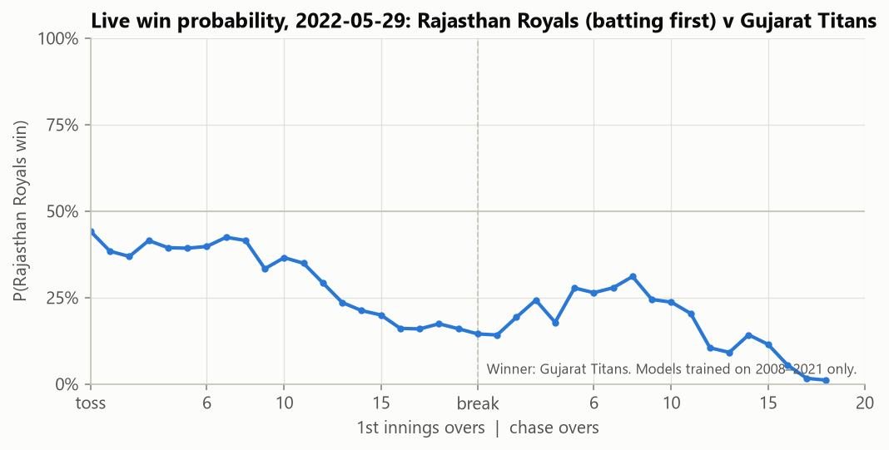

# Live (in-match) models (Phase 4)

Generated by `python -m src.models.live` (live features version 1.0.0). A live prediction is made at the end of an over or at the innings break and gives P(batting-first side wins). The 2023–2024 test seasons were not used.

## Setup

- Sample: 920 full-length decided matches from 2008–2022 (34,889 in-progress states). Matches with D/L or fewer than 20 overs a side are left out.

- One model per innings. Same views as the pre-match models: walk-forward 2015–2022 and validation 2022 (trained on 2008–2021).

- **Selection rule (fixed in advance):** lowest walk-forward log loss over all in-progress states of that innings.

- Checkpoint rows count only matches still in progress at that point; a chase that has already ended is not scored at later checkpoints.

- Pre-match context in every state (Elo, venue chase rate) comes from the leakage-safe pre-match features. The par score is the smoothed mean first-innings total of the previous 60 full-length matches on earlier dates.

## Accuracy by prediction moment (selected models)

Walk-forward 2015–2022, with the 2022 validation accuracy alongside. The pre-match row is the selected pre-match model (see `reports/prematch_models.md`), re-scored on this sample.

| Moment | Model | Matches | Accuracy (95% CI) | ROC-AUC | Log loss | 2022 accuracy (n) |
|---|---|---|---|---|---|---|
| Pre-match, after the toss | Random Forest | 477 | 54.5% ± 4.5% | 0.532 | 0.6890 | 51.4% (74) |
| 1st innings, after 6 overs | Logistic regression | 477 | 60.0% ± 4.4% | 0.615 | 0.6664 | 63.5% (74) |
| 1st innings, after 10 overs | Logistic regression | 477 | 60.4% ± 4.4% | 0.654 | 0.6475 | 70.3% (74) |
| 1st innings, after 15 overs | Logistic regression | 477 | 63.1% ± 4.3% | 0.698 | 0.6200 | 73.0% (74) |
| Innings break (target known) | Logistic regression | 477 | 63.9% ± 4.3% | 0.732 | 0.6016 | 74.3% (74) |
| Chase, after 6 overs | Logistic regression | 477 | 71.7% ± 4.0% | 0.824 | 0.5020 | 74.3% (74) |
| Chase, after 10 overs | Logistic regression | 471 | 77.3% ± 3.8% | 0.851 | 0.4744 | 82.2% (73) |
| Chase, after 15 overs | Logistic regression | 443 | 82.6% ± 3.5% | 0.915 | 0.3650 | 85.3% (68) |

## First innings: model comparison

Features: `overs_done`, `balls_left`, `runs`, `wickets`, `run_rate`, `projected_minus_par`, `par_score`, `elo_prob_bf`, `venue_chase_rate`.

Walk-forward 2015–2022, every in-progress over-end state (n counts states, about 20 per match):

| Model | n | Accuracy (95% CI) | F1 | ROC-AUC | Log loss | Brier |
|---|---|---|---|---|---|---|
| Pre-match Elo only | 9035 | 51.8% ± 1.0% | 0.490 | 0.522 | 0.7004 | 0.2534 |
| Logistic regression | 9035 | 60.4% ± 1.0% | 0.499 | 0.644 | 0.6499 | 0.2302 |
| Random Forest | 9035 | 57.0% ± 1.0% | 0.488 | 0.621 | 0.6604 | 0.2349 |
| XGBoost | 9035 | 56.3% ± 1.0% | 0.502 | 0.587 | 0.7517 | 0.2672 |

Validation 2022, every in-progress state:

| Model | n | Accuracy (95% CI) | F1 | ROC-AUC | Log loss | Brier |
|---|---|---|---|---|---|---|
| Pre-match Elo only | 1397 | 47.5% ± 2.6% | 0.468 | 0.435 | 0.7138 | 0.2602 |
| Logistic regression | 1397 | 65.0% ± 2.5% | 0.596 | 0.723 | 0.6192 | 0.2154 |
| Random Forest | 1397 | 64.9% ± 2.5% | 0.586 | 0.709 | 0.6251 | 0.2189 |
| XGBoost | 1397 | 61.7% ± 2.5% | 0.592 | 0.662 | 0.6626 | 0.2340 |

Walk-forward accuracy at each checkpoint:

| Checkpoint | Pre-match Elo only | Logistic regression | Random Forest | XGBoost |
|---|---|---|---|---|
| 1st innings, after 6 overs | 51.8% | 60.0% | 53.7% | 55.8% |
| 1st innings, after 10 overs | 51.8% | 60.4% | 56.2% | 57.2% |
| 1st innings, after 15 overs | 51.8% | 63.1% | 61.0% | 58.7% |

Selected: **Logistic regression**. Calibration over its walk-forward states (predicted vs observed batting-first win rate):

| Predicted range | States | Mean predicted | Observed |
|---|---|---|---|
| 0%–20% | 490 | 14.2% | 10.8% |
| 20%–40% | 2999 | 32.1% | 36.3% |
| 40%–60% | 4088 | 48.8% | 47.9% |
| 60%–80% | 1235 | 67.5% | 61.4% |
| 80%–100% | 223 | 84.7% | 83.4% |

## Chase (innings break onwards): model comparison

Features: `overs_done`, `balls_left`, `target`, `runs_needed`, `wickets_left`, `required_rate`, `target_minus_par`, `par_score`, `elo_prob_bf`, `venue_chase_rate`.

Walk-forward 2015–2022, every in-progress over-end state (n counts states, about 20 per match):

| Model | n | Accuracy (95% CI) | F1 | ROC-AUC | Log loss | Brier |
|---|---|---|---|---|---|---|
| Pre-match Elo only | 9056 | 51.7% ± 1.0% | 0.496 | 0.521 | 0.7006 | 0.2535 |
| Logistic regression | 9056 | 75.4% ± 0.9% | 0.731 | 0.855 | 0.4609 | 0.1551 |
| Random Forest | 9056 | 74.5% ± 0.9% | 0.732 | 0.835 | 0.4943 | 0.1657 |
| XGBoost | 9056 | 73.2% ± 0.9% | 0.719 | 0.827 | 0.5185 | 0.1742 |

Validation 2022, every in-progress state:

| Model | n | Accuracy (95% CI) | F1 | ROC-AUC | Log loss | Brier |
|---|---|---|---|---|---|---|
| Pre-match Elo only | 1406 | 47.4% ± 2.6% | 0.474 | 0.436 | 0.7133 | 0.2599 |
| Logistic regression | 1406 | 78.9% ± 2.1% | 0.799 | 0.877 | 0.4432 | 0.1453 |
| Random Forest | 1406 | 78.5% ± 2.1% | 0.794 | 0.854 | 0.4831 | 0.1599 |
| XGBoost | 1406 | 77.8% ± 2.2% | 0.790 | 0.865 | 0.4605 | 0.1516 |

Walk-forward accuracy at each checkpoint:

| Checkpoint | Pre-match Elo only | Logistic regression | Random Forest | XGBoost |
|---|---|---|---|---|
| Innings break (target known) | 51.8% | 63.9% | 65.6% | 61.2% |
| Chase, after 6 overs | 51.8% | 71.7% | 70.4% | 70.0% |
| Chase, after 10 overs | 52.0% | 77.3% | 75.2% | 74.1% |
| Chase, after 15 overs | 51.7% | 82.6% | 82.8% | 81.7% |

Selected: **Logistic regression**. Calibration over its walk-forward states (predicted vs observed batting-first win rate):

| Predicted range | States | Mean predicted | Observed |
|---|---|---|---|
| 0%–20% | 2491 | 8.5% | 8.4% |
| 20%–40% | 1723 | 29.8% | 34.1% |
| 40%–60% | 1461 | 49.7% | 47.7% |
| 60%–80% | 1415 | 70.1% | 62.8% |
| 80%–100% | 1966 | 92.1% | 91.6% |

## Example

The chart replays the 2022 final with the selected models trained on 2008–2021 only. The first point is the pre-match Elo probability.
