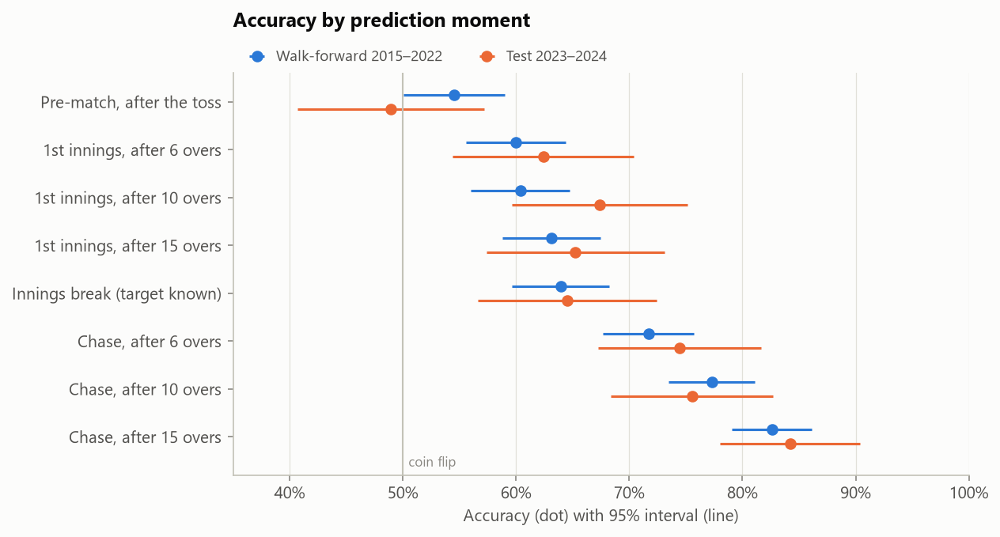

# Model evaluation on the test seasons (Phase 5)

Generated by `python -m src.models.release`. Every model was trained on 2008–2022 and evaluated once on the held-out 2023–2024 seasons. The selected models and the confidence labels were fixed before this evaluation (`src/models/confidence.py`, `reports/calibration_review.md`); the other candidates are shown for transparency only.

The released models (release 1.0.0) are then refitted on 2008–2024 with the same settings, so they can use the two most recent seasons when predicting future matches. The metrics below describe the models trained on 2008–2022.

## Accuracy by prediction moment (selected models)

Live rows count only matches still in progress at that point; the pre-match row is scored on the same full-length matches from the batting-first side's view. The walk-forward column repeats the Phase 4 result for comparison.

| Moment | Walk-forward 2015–2022 (n) | Test accuracy (95% CI) | Test n | Test ROC-AUC | Test log loss |
|---|---|---|---|---|---|
| Pre-match, after the toss | 54.5% (477) | 48.9% ± 8.3% | 141 | 0.526 | 0.6985 |
| 1st innings, after 6 overs | 60.0% (477) | 62.4% ± 8.0% | 141 | 0.676 | 0.6501 |
| 1st innings, after 10 overs | 60.4% (477) | 67.4% ± 7.7% | 141 | 0.707 | 0.6316 |
| 1st innings, after 15 overs | 63.1% (477) | 65.2% ± 7.9% | 141 | 0.731 | 0.6019 |
| Innings break (target known) | 63.9% (477) | 64.5% ± 7.9% | 141 | 0.746 | 0.6313 |
| Chase, after 6 overs | 71.7% (477) | 74.5% ± 7.2% | 141 | 0.825 | 0.5169 |
| Chase, after 10 overs | 77.3% (471) | 75.5% ± 7.1% | 139 | 0.857 | 0.4707 |
| Chase, after 15 overs | 82.6% (443) | 84.2% ± 6.2% | 133 | 0.933 | 0.3288 |

## Pre-match models on 2023–2024

| Model | n | Accuracy (95% CI) | F1 | ROC-AUC | Log loss | Brier |
|---|---|---|---|---|---|---|
| Coin flip (always 50%) | 144 | 52.1% ± 8.2% | 0.685 | 0.500 | 0.6931 | 0.2500 |
| Elo baseline | 144 | 47.9% ± 8.2% | 0.483 | 0.488 | 0.7050 | 0.2558 |
| Logistic regression | 144 | 51.4% ± 8.2% | 0.453 | 0.541 | 0.7143 | 0.2602 |
| Random Forest (selected) | 144 | 48.6% ± 8.2% | 0.339 | 0.525 | 0.6987 | 0.2527 |
| XGBoost | 144 | 47.2% ± 8.2% | 0.321 | 0.505 | 0.7255 | 0.2652 |

By season:

| Season | Coin flip | Elo baseline | Random Forest (selected) | n |
|---|---|---|---|---|
| 2023 | 54.8% | 47.9% | 46.6% | 73 |
| 2024 | 49.3% | 47.9% | 50.7% | 71 |

Selected model by team (matches involving the team):

| Team | Matches | Accuracy |
|---|---|---|
| Chennai Super Kings | 29 | 48.3% |
| Delhi Capitals | 28 | 35.7% |
| Gujarat Titans | 29 | 58.6% |
| Kolkata Knight Riders | 28 | 50.0% |
| Lucknow Super Giants | 28 | 35.7% |
| Mumbai Indians | 30 | 60.0% |
| Punjab Kings | 28 | 39.3% |
| Rajasthan Royals | 29 | 48.3% |
| Royal Challengers Bengaluru | 29 | 55.2% |
| Sunrisers Hyderabad | 30 | 53.3% |

Confusion matrix of the selected model (rows = actual, columns = predicted):

|  | Predicted Team B wins | Predicted Team A wins |
|---|---|---|
| Actual Team B wins | 51 | 18 |
| Actual Team A wins | 56 | 19 |

Confidence labels on the test matches:

| Label | Favourite probability | n | Share | Mean predicted | Favourite won |
|---|---|---|---|---|---|
| Too close to call | 50%–55% | 90 | 62.5% | 52.1% | 47.8% |
| Slight edge | 55%–65% | 54 | 37.5% | 57.5% | 50.0% |
| Clear edge | 65%–80% | 0 | 0.0% | – | – |
| Strong edge | 80%–100% | 0 | 0.0% | – | – |

## Live models on 2023–2024

### First innings

All in-progress over-end states in 2023–2024 (n counts states):

| Model | n | Accuracy (95% CI) | F1 | ROC-AUC | Log loss | Brier |
|---|---|---|---|---|---|---|
| Pre-match Elo only | 2674 | 48.2% ± 1.9% | 0.483 | 0.490 | 0.7052 | 0.2559 |
| Logistic regression (selected) | 2674 | 62.1% ± 1.8% | 0.588 | 0.690 | 0.6377 | 0.2236 |
| Random Forest | 2674 | 63.8% ± 1.8% | 0.656 | 0.696 | 0.6272 | 0.2193 |
| XGBoost | 2674 | 60.5% ± 1.9% | 0.605 | 0.685 | 0.6331 | 0.2235 |

Selected model by season and checkpoint (accuracy, matches in progress):

| Checkpoint | 2023 | 2024 |
|---|---|---|
| 1st innings, after 6 overs | 60.6% (71) | 64.3% (70) |
| 1st innings, after 10 overs | 66.2% (71) | 68.6% (70) |
| 1st innings, after 15 overs | 60.6% (71) | 70.0% (70) |

Confidence labels on the test states:

| Label | Favourite probability | n | Share | Mean predicted | Favourite won |
|---|---|---|---|---|---|
| Too close to call | 50%–55% | 591 | 22.1% | 52.6% | 52.1% |
| Slight edge | 55%–65% | 1051 | 39.3% | 59.8% | 55.9% |
| Clear edge | 65%–80% | 758 | 28.3% | 71.4% | 70.3% |
| Strong edge | 80%–100% | 274 | 10.2% | 86.5% | 85.0% |

### Chase

All in-progress over-end states in 2023–2024 (n counts states):

| Model | n | Accuracy (95% CI) | F1 | ROC-AUC | Log loss | Brier |
|---|---|---|---|---|---|---|
| Pre-match Elo only | 2673 | 48.4% ± 1.9% | 0.494 | 0.494 | 0.7045 | 0.2556 |
| Logistic regression (selected) | 2673 | 77.6% ± 1.6% | 0.798 | 0.864 | 0.4581 | 0.1510 |
| Random Forest | 2673 | 77.3% ± 1.6% | 0.801 | 0.843 | 0.4988 | 0.1624 |
| XGBoost | 2673 | 77.6% ± 1.6% | 0.806 | 0.856 | 0.4865 | 0.1566 |

Selected model by season and checkpoint (accuracy, matches in progress):

| Checkpoint | 2023 | 2024 |
|---|---|---|
| Innings break (target known) | 60.6% (71) | 68.6% (70) |
| Chase, after 6 overs | 69.0% (71) | 80.0% (70) |
| Chase, after 10 overs | 69.0% (71) | 82.4% (68) |
| Chase, after 15 overs | 83.8% (68) | 84.6% (65) |

Confidence labels on the test states:

| Label | Favourite probability | n | Share | Mean predicted | Favourite won |
|---|---|---|---|---|---|
| Too close to call | 50%–55% | 178 | 6.7% | 52.4% | 49.4% |
| Slight edge | 55%–65% | 336 | 12.6% | 59.9% | 56.5% |
| Clear edge | 65%–80% | 616 | 23.0% | 73.0% | 68.5% |
| Strong edge | 80%–100% | 1543 | 57.7% | 92.1% | 89.0% |
